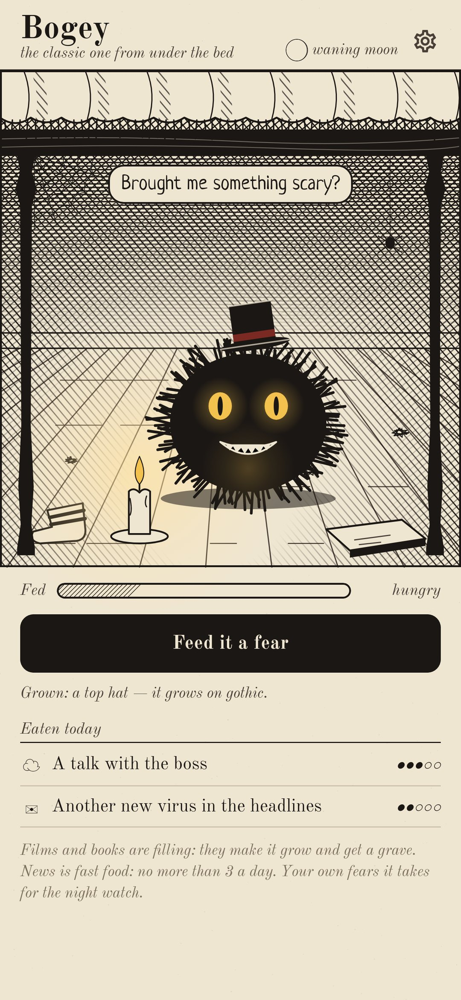
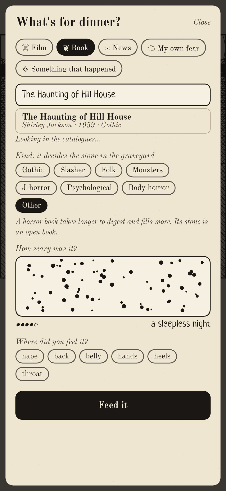
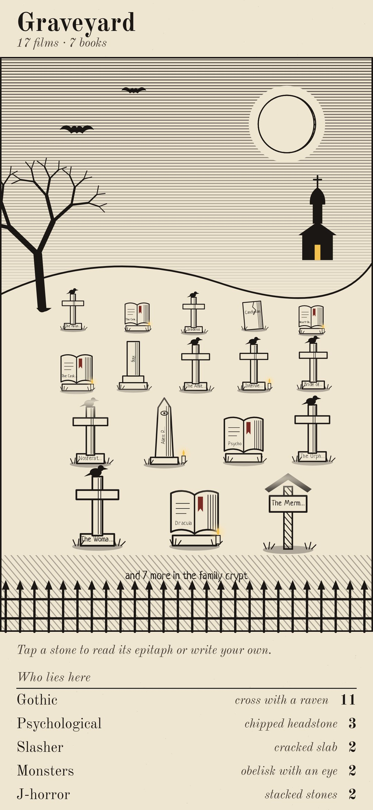
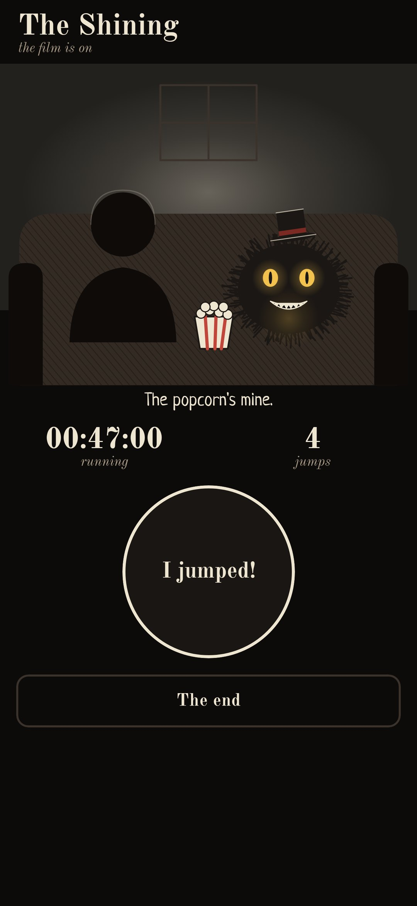
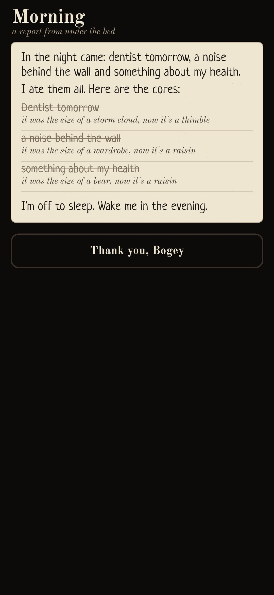

<div align="center">


# Underbed

### Something lives under your bed, and it eats fear

*As a child you were afraid of it. Now you can feed it. Log the horror films you watched and the horror books you read: they fill it up, it grows, and each one gets a grave in the graveyard on the hill. Anxious news is fast food, and after three a day it covers its mouth. Your own fears it takes for the night: lights out, two eyes glow under the bed, and in the morning you get back the cores. Free, no ads, no account.*

[](https://github.com/bigdevwhale/underbed/actions/workflows/android.yml)


[](LICENSE)

**English** · [Русский](README.ru.md) · [Changelog](CHANGELOG.md)

    

</div>

---

## How it works

1. **Who lives there.** Pick one of seven creatures: the Bogey, a Ghost, a Zombie, a Vampire, a Werewolf, a Doll or a Kikimora. Each has its favourite kinds of horror. The werewolf howls at the real full moon.
2. **Feeding.** There are five kinds of food:
   - a horror **film**;
   - a horror **book**;
   - **news**;
   - **your own fear**;
   - **something that happened**, like the dark stairwell.

   Films and books are found as you type. A bundled catalogue of about 300 classics works offline. Online, films come from Wikidata, and books from Fantlab and Open Library, with Google Books as a fallback.
3. **The goosebump meter.** Hold a finger down while it's scary: bumps rise and the level climbs from "a little" to "still scared". Then say where you felt it.
4. **Fast food.** News fills the pet up a little. After three a day it covers its mouth with its paws: "I'm full. Go for a walk."
5. **It grows.** After five films or books of one kind, something grows on the pet:
   - gothic gives it a top hat;
   - folk horror gives it twig antlers;
   - monsters give it tentacles;
   - J-horror gives it long wet hair.
6. **The graveyard.** Each film or book gets a grave on the hill, and the stone matches the kind of horror:
   - a cross with a raven for gothic;
   - a roofed wooden post for folk;
   - an obelisk with an eye for monsters;
   - stacked stones for J-horror;
   - an open book for every book.

   Write an epitaph on any of them.
7. **The night watch.** Before sleep, name what frightens you tonight. The screen turns into a night light with two eyes under the bed. In the morning there's a report: "In the night came the dentist and the noise behind the wall. I ate them. It was the size of a wardrobe, now it's a pea."
8. **Film night.** The pet sits next to you on the couch with the popcorn. The phone in your hand feels you start, or you press the button. Afterwards the pet writes a review: how many times you jumped, and at which minute.
9. **Special nights.**
   - At 3 a.m. it has a secret to tell.
   - On Halloween it brings you a sweet.
   - On Friday the 13th it eats its best.
10. **No guilt.** Left hungry for days, it doesn't die. It falls asleep in the wardrobe and wakes up when you feed it.

The internet is used only to look films and books up. Everything else stays on the phone.

## Build

```
./gradlew testDebugUnitTest assembleDebug
./gradlew -Pdemo assembleDebug          # app.underbed.demo with six weeks of meals, graves and nights
./gradlew testDebugUnitTest -Prender --tests '*RenderArt*'   # the pets, the scene, the icon and every screen to app/build/art
python tools/shots.py app/build/art     # README screenshots from the renders
python tools/icon.py                    # launcher icon vectors
```

- **Art.** Everything is drawn in code, in cross-hatched ink: the creatures in `ui/art/Pet.kt`, the room under the bed in `Bed.kt`, the graveyard in `Yard.kt`.
- **Catalogue.** The bundled one is `app/src/main/assets/horror.tsv`.

Fonts: [Old Standard TT](https://fonts.google.com/specimen/Old+Standard+TT) and [Neucha](https://fonts.google.com/specimen/Neucha), SIL Open Font License.
