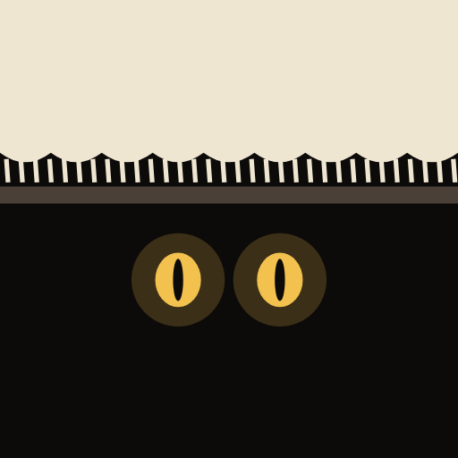
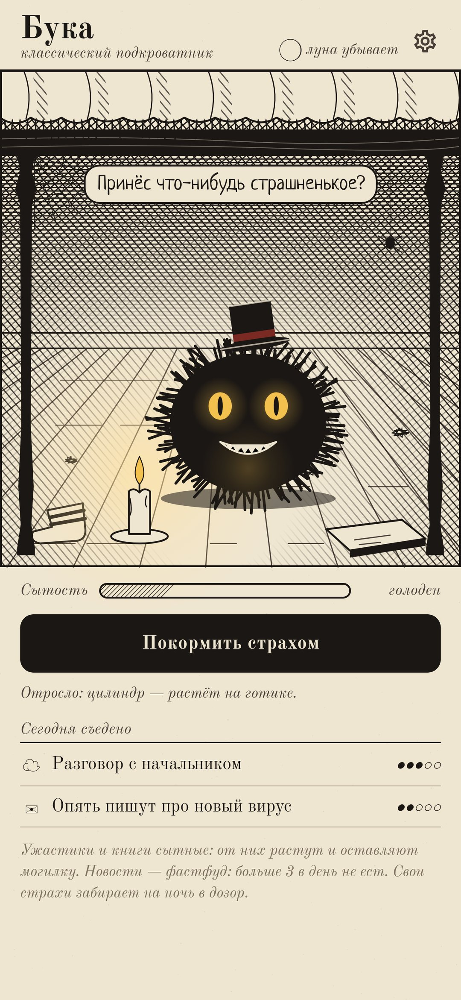
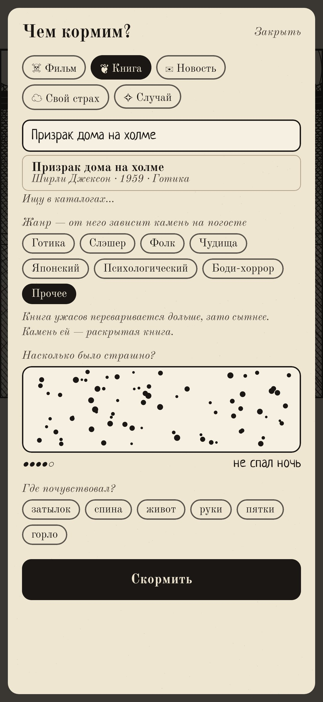
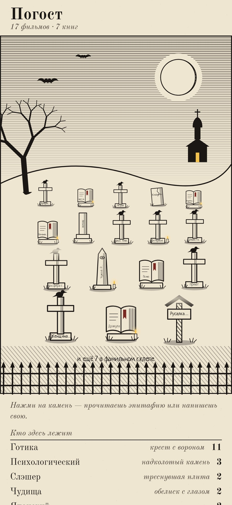
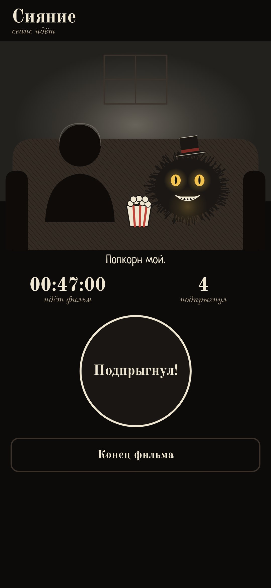
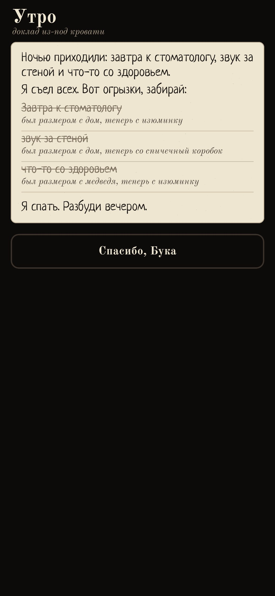

<div align="center">



# Бука

### Под твоей кроватью кто-то есть, и он ест страх

*В детстве ты его боялся. Теперь его можно кормить. Записывай, какие ужастики посмотрел и какие книги ужасов прочитал: от них Бука растёт, а каждому фильму и каждой книге достаётся могилка на погосте. Тревожные новости для него фастфуд: больше трёх за день он есть не станет. Свои страхи он забирает на ночь: гасишь свет, под кроватью горят два глаза, а утром тебе возвращают огрызки. Бесплатно, без рекламы, без аккаунта.*

[](https://github.com/bigdevwhale/underbed/actions/workflows/android.yml)


[](LICENSE)

[English](README.md) · **Русский** · [Изменения](CHANGELOG.md)

    

</div>

---

## Как это устроено

1. **Кто там живёт.** Выбери одного из семи: Бука, Призрак, Зомби, Вампир, Оборотень, Кукла или Кикимора. У каждого свои любимые жанры. Оборотень воет на настоящее полнолуние.
2. **Кормление.** Еда бывает пяти видов:
   - **фильм** ужасов;
   - **книга** ужасов;
   - **новость**;
   - **свой страх**;
   - **случай** вроде тёмного подъезда.

   Фильмы и книги ищутся, пока печатаешь. Без интернета работает встроенный каталог примерно из 300 классических вещей. С интернетом фильмы ищутся в Wikidata, а книги на Фантлабе и в Open Library, если там нет — в Google Books.
3. **Мурашкометр.** Держи палец на экране, пока страшно: высыпают мурашки, и уровень растёт от «чуть-чуть» до «до сих пор боюсь». Потом отметь, где почувствовал: затылок, живот или пятки.
4. **Фастфуд.** От новостей Бука сытеет понемногу. После трёх за день он закрывает пасть лапами: «Я сыт. Иди погуляй».
5. **Растёт.** После пяти фильмов или книг одного жанра на Буке что-то отрастает:
   - от готики цилиндр;
   - от фолка рожки из веток;
   - от чудищ щупальца;
   - от японского ужаса длинные мокрые волосы.
6. **Погост.** Каждому фильму и каждой книге достаётся могилка на холме, и камень зависит от жанра:
   - крест с вороном для готики;
   - голубец для фолка;
   - обелиск с глазом для чудищ;
   - каменная стопка для японского ужаса;
   - раскрытая книга для любой книги.

   На любом камне можно написать эпитафию.
7. **Ночной дозор.** Перед сном назови, что пугает сегодня. Экран станет ночником, и под кроватью останутся только два глаза. Утром придёт доклад: «Ночью приходили стоматолог и звук за стеной. Я съел обоих. Был размером со шкаф, теперь с горошину».
8. **Кино-ночь.** Бука сидит рядом на диване с попкорном. Телефон в руке сам чувствует, когда ты вздрагиваешь, или можно жать кнопку. После фильма Бука пишет рецензию: сколько раз ты подпрыгнул и на какой минуте.
9. **Особые ночи.**
   - В три часа ночи у Буки есть секрет.
   - На Хэллоуин он принесёт конфету.
   - Пятница, 13-е — самый вкусный день в году.
10. **Без вины.** Если долго не кормить, Бука не умирает. Он засыпает в шкафу и просыпается, когда покормишь.

Интернет нужен только для поиска фильмов и книг. Всё остальное хранится на телефоне.

## Сборка

```
./gradlew testDebugUnitTest assembleDebug
./gradlew -Pdemo assembleDebug          # app.underbed.demo с шестью неделями еды, могил и ночей
./gradlew testDebugUnitTest -Prender --tests '*RenderArt*'   # чудища, сцена, иконка и все экраны в app/build/art
python tools/shots.py app/build/art     # скриншоты для README из рендеров
python tools/icon.py                    # векторы иконки
```

Всё нарисовано в коде, тушью со штриховкой. Шрифты: Old Standard TT и Neucha, SIL Open Font License.
